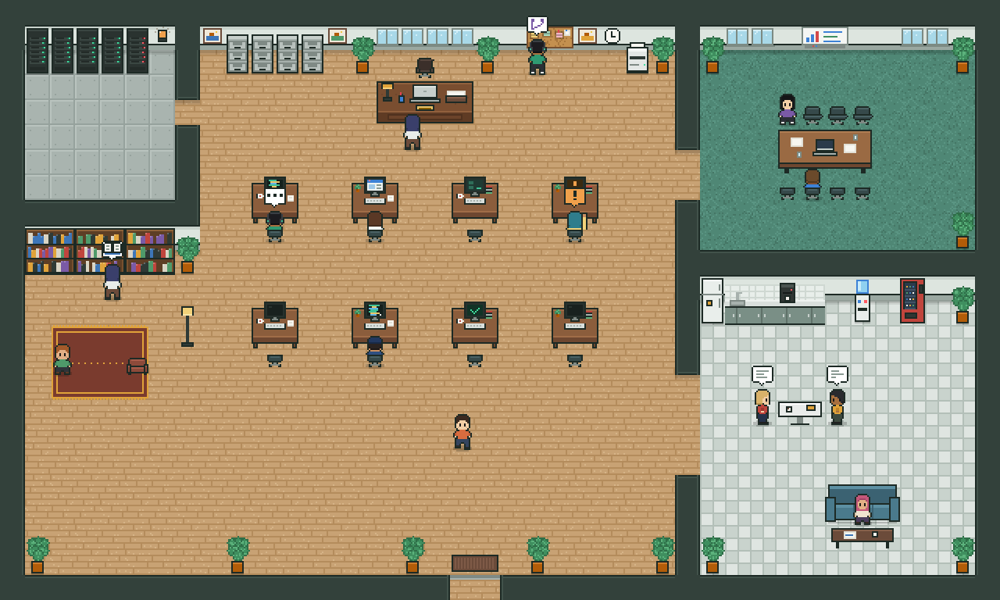

# Office map and art

The office view loads everything from this folder at runtime. The hub serves it at `/api/office/assets/<file>` from `MAPS_DIR` (default `./maps`). To re-skin the office, replace files here and reload the page. You do not need to rebuild the web app.



## Files

- **`office.tmj`**: the Tiled map (40×24 tiles, 16 px). Open it in [Tiled](https://www.mapeditor.org/) 1.10 or newer.
- **`tiles.png`**: the tileset used by the map.
- **`characters.png` + `characters.json`**: worker sprites as a Phaser/TexturePacker JSON-hash atlas.
  - There is one row per look (`guard`, `tester`, `coder`, `marketer`, `person-1` … `person-8`), and every frame is 16×24.
  - The frame names are `<look>/<frame>`: `down`, `down_walk1`, `down_walk2`, `up…`, `right…`, `left…`, `sit_up`, `sit_up_type1`, `sit_up_type2`, `sit_up_hand`, `sit_down` and `down_hand`.
- **`props.png` + `props.json`**: the live props, also an atlas:
  - monitor screens
  - rack LEDs
  - the server lamp
  - the owner's in-tray
  - notice-board notes
  - chairs
  - speech bubbles
  - effects
- **`preview.png`**: the whole office at 2×, so you can review it without running anything.

## Map layers

| Layer | Kind | Used for |
| --- | --- | --- |
| `floor`, `walls`, `furniture` | tiles | drawn under the characters |
| `overhead` | tiles | drawn over the characters (plant tops, lamp heads) |
| `collision` | tiles, hidden | any tile here blocks walking (pathfinding grid) |
| `places` | points | where characters go. `type` is `desk`, `seat` or `spot`. The properties are `zone`, `facing` (`up`/`down`/`left`/`right`) and `chair` (`back`/`front`/`arm`/`none`). The point is where the feet go. |
| `props` | points | live props: `screen` (`desk` = n), `rack` (`rack` = n), `lamp`, `tray`, `notice_board`, `decor` (`frame` = atlas frame, bottom-centre anchor) |
| `zones` | rectangles | named areas: `owner_desk`, `desks`, `server_room`, `meeting_room`, `whiteboard`, `notice_board`, `file_cabinets`, `library`, `pantry`, `entrance` |

The map properties `characters` and `props` name the atlas files. Change them to point at your own art.

## Rebuilding from code

```sh
bun run --cwd apps/web office:assets
```

This redraws every file here from `apps/web/src/office/` and overwrites any hand edits. Pick one source of truth:

- Edit the code and rebuild, or
- Edit `office.tmj` in Tiled and stop running the build script.

A test (`apps/web/test/office-art.test.ts`) fails when the files here and the art code drift apart. Delete that test if you move to editing in Tiled.
